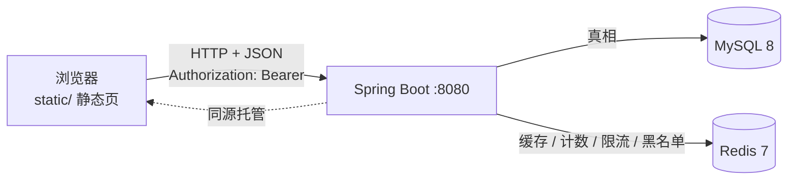

# 架构说明

---

## 一、项目定位

一个「用户中心 + 内容社区」后端，把 Java 后端的常见工程能力串成一条完整链路：

注册登录 → 鉴权注销 → 内容发布与游标分页 → 点赞与热榜 → 限流与幂等 → 统一错误契约

它不是玩具 CRUD：每个功能点都对应一个真实故障场景（重复点赞、缓存穿透、深翻页重复、密码爆破、网络重试重复提交、Redis 抖动）。

---

## 二、整体结构



**同源**是关键：前端页面与后端在同一进程、同一端口，所以没有 CORS、没有第二个服务要起、没有前端环境变量要配。clone 下来一条命令就能看到界面。

一次点赞的写入顺序（`LikeService#like`）：

```
校验内容 → 写 DB（唯一键 INSERT IGNORE，真相）→ 更新计数 → 尽力维护 Redis（失败只记日志）→ 更新热榜 ZSet
```

方向是**以 DB 为准，Redis 是可丢弃的加速层**。反过来（以 Redis 为准）会导致 Redis 重启后计数永久错乱。

---

## 三、技术选型

| 层 | 选型 | 为什么 |
| --- | --- | --- |
| 运行时 | Java 21（源码保持 17 兼容语法） | 环境新、语法保守，换 JDK 不用改代码 |
| 框架 | Spring Boot 3.x | 自动装配 + Actuator 健康检查，省掉自建脚手架 |
| 持久层 | MyBatis 注解 Mapper | SQL 直接可见，排错不用猜；不用 JPA 是因为本项目大量依赖 `INSERT IGNORE`、`GREATEST`、游标条件这类非标准 SQL |
| 缓存/计数 | Redis 7 | Set 去重、ZSet 排行、`INCR` 限流、jti 黑名单，四件事一套组件解决 |
| 鉴权 | JJWT + 自定义拦截器 | 不引 `spring-boot-starter-security`：它会默认给全站加 Basic 认证，反而要写更多配置去关掉；本项目只需要 BCrypt + 自己签发验签 |
| 密码 | BCrypt（cost=10） | 自带盐、计算慢（约 50~100ms/次），天然抗彩虹表与暴力枚举 |
| 前端 | 原生 JS + 同源静态页 | 零构建，由 Spring Boot 同源托管，无 CORS、无第二个进程 |

---

## 四、关键设计决策

| # | 决策 | 问题 | 方案 | 代价 |
| --- | --- | --- | --- | --- |
| 1 | 统一响应体 + 5 位错误码 | 每个接口格式各异，前端要写 N 套判断 | `Result{code,message,data}` + `GlobalExceptionHandler` 收口；错误码 = HTTP 状态码(3位) + 序号(2位) | 每层多一次包装；业务码与 HTTP 状态码需同时维护（用编码规则消除歧义） |
| 2 | JWT + jti 黑名单登出 | 无状态 token 无法主动作废 | 登出把 jti 写 Redis，TTL = `exp − now` | 鉴权路径每次多一次 Redis 查询；用「先验签再查黑名单」把伪造请求挡在前面，降低被刷的成本 |
| 3 | 游标分页而非 offset | 深翻页时新数据插入导致重复/漏条 | `WHERE id < cursor ORDER BY id DESC LIMIT n`，游标取上一页最后一条 id | 不能跳页；写成 `<=` 会重复，必须严格 `<` |
| 4 | 详情缓存空值 `__NULL__` | 不存在的 id 被反复打库（缓存穿透） | 查不到也缓存一个短 TTL 的空标记 | 新建内容若复用同 id 需删该 key（本项目 id 自增，冲突概率极低） |
| 5 | 点赞幂等靠唯一键 | 重复点赞把计数加爆 | 唯一键 + `INSERT IGNORE`，只有 `inserted == 1` 才加计数 | 不能拿 Redis `SADD` 返回值当判据，Redis 只是加速层 |
| 6 | `like_count INT UNSIGNED` + `GREATEST(x-1,0)` | 裸减 1 在 0 上会报 1690 越界 | `GREATEST(like_count - 1, 0)` | 兜底会掩盖「计数已不一致」的事实，长期需要定时对账 |
| 7 | 热榜用 ZSet，丢失可懒重建 | 每次实时排序开销大 | `ZINCRBY` 维护，Top N 取 `ZREVRANGE`；缓存丢失时在读取路径上重建 | 重建存在「DEL 之后、ZADD 之前」的短暂窗口 |
| 8 | 固定窗口限流 | 登录接口可被暴力枚举 | Redis `INCR` + 首请求设 `EXPIRE` | 窗口边界可产生双倍突发；且 `EXPIRE` 绝不能每次重设，否则越试越锁死 |
| 9 | 幂等键 + DB 唯一键双保险 | 网络重试导致重复发布 | `Idempotency-Key` 先走 Redis 记响应（重放返回同 id）；Redis 丢了由 `uk_user_idem` 兜底，整体回 200 而非 201 | 需要业务表上多一列 + 唯一索引 |
| 10 | Redis 故障降级 | Redis 抖一下用户就点不了赞 | 写路径以 DB 为准，Redis 失败只 `log.warn` 不影响请求成功 | 降级期间计数缓存与热榜短暂不准 |

**决策 2、8、9 有一个共同点：Redis 永远不是唯一真相。** 这是本项目最想说明的一句话——缓存能提升性能，但不能成为正确性的依赖。

---

## 五、目录结构

```
src/main/java/com/community/
├── common/     统一响应、错误码、异常、traceId、用户上下文、限流、Redis 安全
├── auth/       注册 / 登录 / JWT 签发验签 / 鉴权拦截器 / 登出黑名单
├── user/       用户资料读写
├── content/    内容发布、游标分页、详情缓存、软删、热榜
└── like/       点赞关系、计数、ZSet 热榜、Redis 降级
src/main/resources/
├── application.yml
└── static/     前端页面（同源托管）
```

按**能力**分包，不按 `controller/service/mapper` 分层——后者会让一个功能的改动散落在四个目录，评审时要在文件树里跳来跳去。
