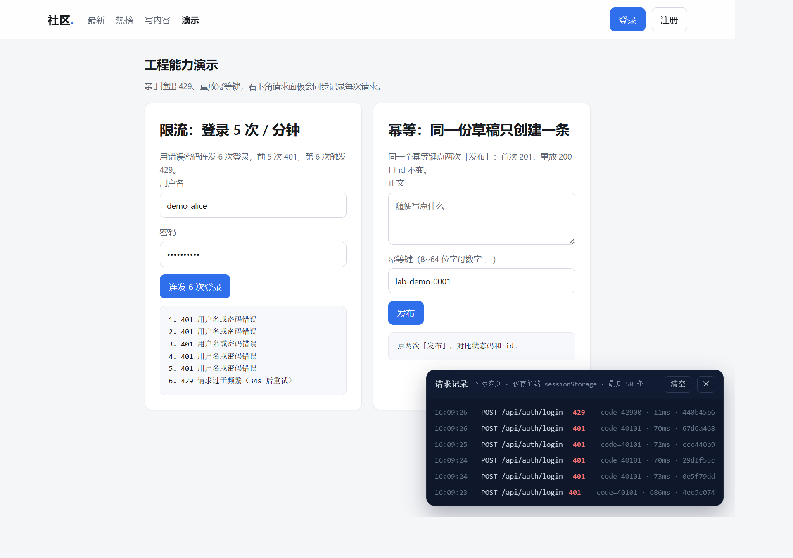

# community · 用户中心 + 内容社区

> Java + Spring Boot 3 的内容社区后端：注册登录 → JWT 鉴权 → 内容发布与游标分页 →
> 点赞与 Redis 热榜 → 评论 / 搜索 / 标签 / 收藏 → 限流与幂等。
> 附一个同源前端页，clone 下来两条命令就能看到界面，以及每个请求的状态码。

## 界面

- 首页：匿名可读信息流与热榜，支持关键词搜索；点赞、发布需要登录
- 详情页：点赞 / 收藏 / 评论；发布页可选预置标签
- 管理页（仅 `demo_admin`）：按用户 ID 封禁 / 解封，封禁立即生效
- 右下角 **请求日志**：每次调用显示「方法 路径 状态码 traceId 耗时」，可以现场撞出 `429`，
  也能看到幂等重放返回的 `200`




## 快速开始

前置：JDK 17+、Maven 3.9+、Docker（只用来起 MySQL 与 Redis）。

```bash
docker compose up -d                    # 起 MySQL 8 + Redis 7，首次启动会自动建表
DB_PASSWORD=root mvn spring-boot:run    # 启动应用
# 然后打开 http://localhost:8080
```

> compose 里 MySQL 的 root 密码是 `root`，而 `application.yml` 的默认是空密码，
> 所以第二条要带 `DB_PASSWORD=root`。
> 本机已有 MySQL / Redis 占着默认端口时，看 [docker-compose.yml](docker-compose.yml) 顶部的端口覆盖写法。

JWT 密钥不配也能跑：没设 `JWT_SECRET` 时，启动会生成一把一次性随机密钥（日志打 WARN），
代价是重启后已经发出去的 token 全部失效。对外部署必须显式给一把，至少 32 字节：

```bash
export JWT_SECRET="$(openssl rand -base64 32)"
```

早期版本的 `application.yml` 里写死过一个默认密钥，它仍留在 git 历史中，本项目没有改写历史；
当前代码不含任何可用的密钥。

想看有内容的界面（5 个用户 / 8 条内容 / 9 条点赞）：

```bash
mysql -uroot -proot -h127.0.0.1 community < deploy/sql/seed-demo.sql
redis-cli DEL hot:content               # 让热榜从 DB 重建
```

演示账号：`demo_alice` / `demo_bob` / `demo_carol` / `demo_dave`（普通用户）与 `demo_admin`（管理员，可封禁/解封），密码都是 `Passw0rd!2026`。

不灌演示数据也能跑完所有功能，首页会显示空态。注意：**演示数据不要带进 `mvn test`**，
分页用例假设 `content` 表为空（所以 seed 刻意没有挂进 `docker-entrypoint-initdb.d`）。

## 目录结构

```
community/
├── src/main/java/com/community/
│   ├── common/          统一响应、错误码、异常、traceId、用户上下文、限流
│   ├── auth/            注册 / 登录 / JWT / 鉴权拦截器 / 登出黑名单
│   ├── user/            用户资料、修改密码、管理员封禁
│   ├── content/         发布、搜索、游标分页、详情缓存、软删、热榜
│   ├── comment/         一级评论与评论计数
│   ├── tag/             预置标签与按标签浏览
│   ├── bookmark/        收藏关系
│   └── like/            点赞关系、计数、ZSet 热榜、Redis 降级
├── src/main/resources/
│   ├── application.yml
│   └── static/          前端页（同源托管，零构建）
├── src/test/java/com/community/   25 个测试类 / 98 个用例
├── ARCHITECTURE.md               每条设计决策的问题、方案与代价
├── API.md                        29 个接口的完整契约
├── deploy/sql/
│   ├── schema.sql       建表
│   ├── seed-demo.sql    演示数据
│   └── migrations/      增量迁移
├── docker-compose.yml   只起 MySQL + Redis
└── .githooks/commit-msg 提交信息校验
```

按**能力**分包，不按 `controller/service/mapper` 分层：后者会让一个功能的改动散落在四个目录里。

## 技术栈

Java 21 / Spring Boot 3.5 / MyBatis（注解 Mapper）/ MySQL 8 / Redis 7 / JJWT + BCrypt /
原生 JS 静态页（零构建、同源托管）。每一层的选型理由见 [ARCHITECTURE.md](ARCHITECTURE.md)。

## 开发规范

提交信息只接受 `type(scope): 描述`，由 `.githooks/commit-msg` 校验。详见 [CONTRIBUTING.md](CONTRIBUTING.md)。

```bash
git config core.hooksPath .githooks   # 首次 clone 后执行一次
```

## License

[MIT](LICENSE)。这是一个学习 / 求职用的项目，不建议直接上生产。
