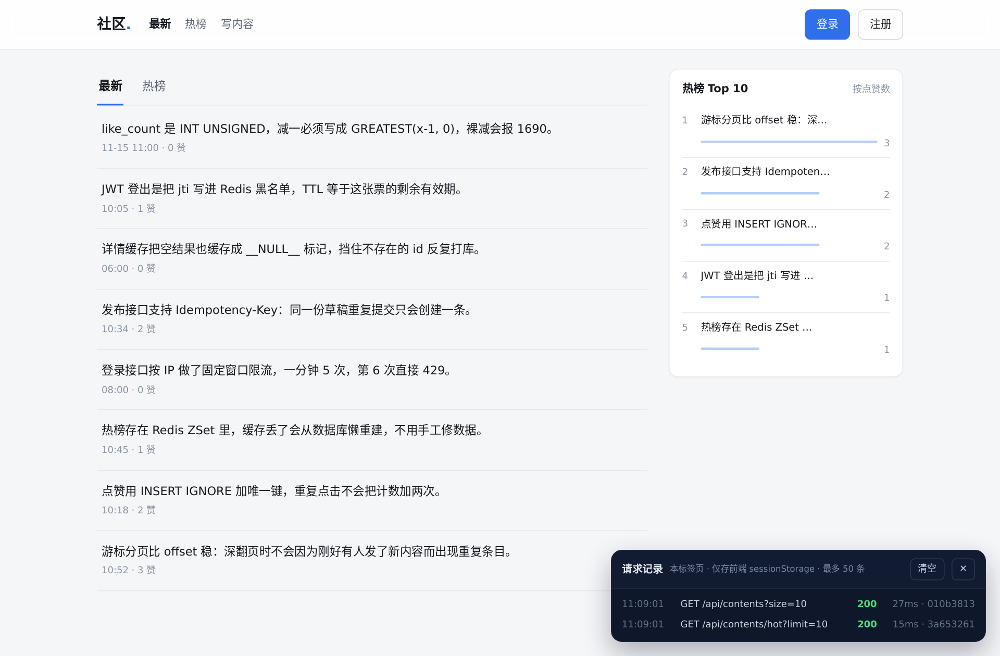
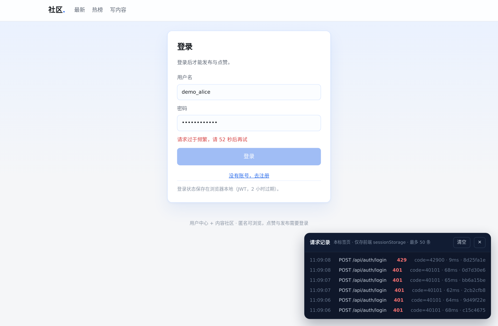

# community · 用户中心 + 内容社区

> Java + Spring Boot 3 的内容社区后端：注册登录 → JWT 鉴权 → 内容发布与游标分页 →
> 点赞与 Redis 热榜 → 限流与幂等。
> 附一个同源前端页，clone 下来两条命令就能看到界面，以及每个请求的状态码。

## 这套代码想证明什么

不是「我写了一个 CRUD」，而是「我知道每个功能在什么场景下会坏，以及在哪儿挡住的」。

| 故障场景 | 怎么挡的 | 在哪儿 |
| --- | --- | --- |
| 重复点赞把计数加爆 | 唯一键 + `INSERT IGNORE`，只有 `inserted == 1` 才加计数 | `LikeService#like` |
| 深翻页出现重复 / 漏条 | 游标分页 `WHERE id < cursor ORDER BY id DESC` | `ContentMapper#page` |
| 不存在的 id 反复打库 | 空结果也缓存成 `__NULL__` 标记（短 TTL） | `ContentService#detail` |
| 网络重试发出两条内容 | `Idempotency-Key` 先走 Redis，DB 唯一键 `uk_user_idem` 兜底 | `ContentService#publish` |
| 密码被暴力枚举 | 登录按 IP 固定窗口限流 5 次/分钟，429 带 `Retry-After` | `RateLimitInterceptor` |
| 登出后 token 还能用 | jti 写入 Redis 黑名单，TTL = `exp − now` | `AuthService#logout` |
| 计数减成负数报 1690 | `like_count` 是 `INT UNSIGNED`，减一写 `GREATEST(x-1, 0)` | `ContentMapper#addLikeCount` |
| Redis 挂了点赞全失败 | 写路径以 DB 为准，Redis 失败只记日志 | `LikeService#like` |

**一句话总结：Redis 是加速层，不是唯一真相。** 缓存丢了，热榜与点赞集合都能从 MySQL 重建。

## 界面

- 首页：匿名可读信息流与热榜；点赞、发布需要登录
- 右下角 **请求日志**：每次调用显示「方法 路径 状态码 traceId 耗时」，可以现场撞出 `429`、
  也能看到幂等重放返回的 `200`






## 快速开始

前置：JDK 17+、Maven 3.9+、Docker（只用来起 MySQL 与 Redis）。

```bash
docker compose up -d                    # 起 MySQL 8 + Redis 7，首次启动会自动建表
DB_PASSWORD=root mvn spring-boot:run    # 启动应用
# 然后打开 http://localhost:8080
```

> compose 里 MySQL 的 root 密码是 `root`，而 `application.yml` 的默认是空密码，
> 所以第二条要带 `DB_PASSWORD=root`。
> 本机已有 MySQL / Redis 占着默认端口时，看 [docker-compose.yml](docker-compose.yml) 顶部的端口覆盖写法。

想看有内容的界面（4 个用户 / 8 条内容 / 9 条点赞）：

```bash
mysql -uroot -proot -h127.0.0.1 community < deploy/sql/seed-demo.sql
redis-cli DEL hot:content               # 让热榜从 DB 重建
```

演示账号：`demo_alice` / `demo_bob` / `demo_carol` / `demo_dave`，密码都是 `Passw0rd!2026`。

不灌演示数据也能跑完所有功能，首页会显示空态。注意：**演示数据不要带进 `mvn test`**，
分页用例假设 `content` 表为空（所以 seed 刻意没有挂进 `docker-entrypoint-initdb.d`）。

## 技术栈

| 层 | 选型 |
| --- | --- |
| 语言 / 运行时 | Java 21（源码保持 17 兼容语法） |
| 框架 | Spring Boot 3.5（Web / Actuator / Validation / Test） |
| 持久层 | MyBatis 注解 Mapper + MySQL 8 |
| 缓存 | Redis 7（计数器 / ZSet 热榜 / 限流 / 黑名单） |
| 鉴权 | JJWT + BCrypt + 自定义拦截器（不引 `starter-security`） |
| 前端 | 同源静态页（原生 JS + 手写 CSS，零构建） |

## 目录结构

```
community/
├── src/main/java/com/community/
│   ├── common/          统一响应、错误码、异常、traceId、用户上下文、限流
│   ├── auth/            注册 / 登录 / JWT / 鉴权拦截器 / 登出黑名单
│   ├── user/            用户资料
│   ├── content/         发布、游标分页、详情缓存、软删、热榜
│   └── like/            点赞关系、计数、ZSet 热榜、Redis 降级
├── src/main/resources/
│   ├── application.yml
│   └── static/          前端页（同源托管，零构建）
├── src/test/java/com/community/   14 个测试类 / 50 个用例
├── ARCHITECTURE.md               每条设计决策的问题、方案与代价
├── API.md                        13 个接口的完整契约
├── deploy/sql/
│   ├── schema.sql       建表
│   ├── seed-demo.sql    演示数据
│   └── migrations/      增量迁移
├── docker-compose.yml   只起 MySQL + Redis
└── .githooks/commit-msg 提交信息校验
```

按**能力**分包，不按 `controller/service/mapper` 分层：后者会让一个功能的改动散落在四个目录里。

## 接口

13 个接口，完整契约（请求体、响应体、错误码）见 [API.md](API.md)。

| 方法 | 路径 | 鉴权 | 说明 |
| --- | --- | --- | --- |
| POST | `/api/auth/register` | 匿名 | 注册，创建成功返回 201 |
| POST | `/api/auth/login` | 匿名 | 登录，按 IP 限流 5 次 / 分钟 |
| POST | `/api/auth/logout` | 需要 | 登出，jti 进黑名单 |
| GET | `/api/me` | 需要 | 当前用户资料 |
| PATCH | `/api/me` | 需要 | 部分更新（只改传了的字段） |
| GET | `/api/contents` | 匿名 | 游标分页信息流 |
| POST | `/api/contents` | 需要 | 发布，支持 `Idempotency-Key` |
| GET | `/api/contents/{id}` | 匿名 | 详情（带缓存） |
| DELETE | `/api/contents/{id}` | 需要 | 软删，只能删自己的 |
| POST | `/api/contents/{id}/like` | 需要 | 点赞，幂等 |
| DELETE | `/api/contents/{id}/like` | 需要 | 取消点赞 |
| GET | `/api/contents/{id}/like` | 需要 | 当前用户的点赞态 |
| GET | `/api/contents/hot` | 匿名 | 热榜 Top N |

统一响应体：`{"code": 0, "message": "成功", "data": ...}`。
`code` 非 0 时是 5 位业务错误码，前三位即对应的 HTTP 状态码（如 `40901` → 409）。

## 测试

```bash
mvn test
```

14 个类 / 50 个用例，跑在真实的 MySQL + Redis 上（没有把存储 mock 掉）。

| 关注点 | 用例在验什么 |
| --- | --- |
| 密码与 JWT | BCrypt 同密码不同哈希；六种无效 token 全部拒绝 |
| 鉴权边界 | 无 token / 篡改 / 过期 / 黑名单；匿名可读，写接口仍 401 |
| 分页与缓存 | 游标三页无重复；缓存 miss → hit；空值标记挡住穿透 |
| 点赞与热榜 | 重复点赞计数不变；ZSet 与 SQL 排序一致；缓存清空后自动重建 |
| 并发与降级 | 50 线程并发点赞只落 1 行；Redis 全挂时点赞仍成功 |
| 端到端 | 注册 → 登录 → 发布（幂等）→ 列表 → 详情 → 删除 → 404 |

## 设计决策

游标分页、点赞幂等、空值缓存、限流窗口、Redis 降级等 10 条取舍，每条都按
「问题 → 方案 → 代价」写在 [ARCHITECTURE.md](ARCHITECTURE.md)。没写代价的方案等于没评估过。

## 开发规范

提交信息只接受 `type(scope): 描述`，由 `.githooks/commit-msg` 校验。详见 [CONTRIBUTING.md](CONTRIBUTING.md)。

```bash
git config core.hooksPath .githooks   # 首次 clone 后执行一次
```
